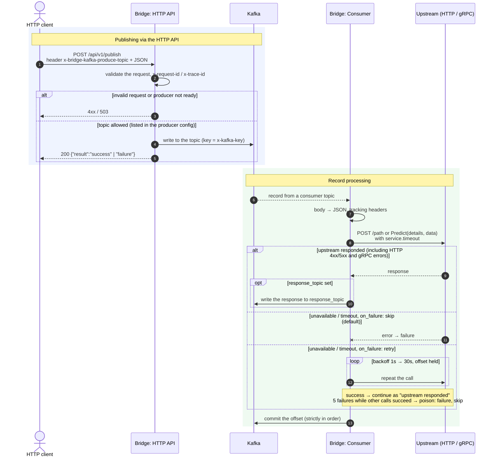

# bridge-kafka-service message flow

The service bridges Kafka and a business service (upstream). It has two independent paths:

- **Publishing:** HTTP client → `POST /api/v1/publish` → Kafka topic.
- **Processing:** Kafka topic → upstream (HTTP or gRPC) → response to `response_topic`.

At every step the service writes `controller_kafka_*` metrics to a file and audit to ALS
(file and gRPC). They are not shown on the diagram.

## Key points

- **The offset is committed after processing.** A record counts as processed when
  the response is written to Kafka or the upstream call has finally failed. Offsets
  are committed strictly in read order. If a call is aborted on shutdown,
  the record is redelivered.
- **Response publication follows `on_failure` too.** Under `skip` a failed write to
  `response_topic` is recorded as a failure and the offset is settled. Under
  `retry` the write is repeated with the shared backoff (1s doubling up to 30s)
  until it succeeds, the offset held and the upstream not called again; only a
  non-transient error (for example a record too large for the broker) is settled
  as a failure. On shutdown the wait ends, an unpublished response is not settled
  and its record is redelivered.
- **Upstream failures follow `on_failure`.** A failure is only "unavailable / timeout";
  any HTTP status or gRPC status is a response. `skip` (default) records a failure and
  commits the offset. `retry` holds the offset and repeats the call with backoff until
  the upstream recovers, so an outage loses nothing. A record that keeps failing while
  other calls succeed is treated as poison and skipped after 5 attempts. Requires
  `service.max_conn`.
- **The HTTP API returns 200 even if the Kafka write failed.** The outcome is
  in the `result` field.
- **One producer for all topics.** Only topics from the `producer` config can be
  published to, both via the HTTP API and via `response_topic`.
- **Concurrency:** `service.max_conn > 0` limits concurrent upstream calls to
  that number; otherwise fast mode applies a built-in ceiling of 512 concurrent
  calls per pipeline (reading pauses until a call finishes). Each HTTP upstream
  keeps its own connection pool sized to the pipeline's limit, so calls reuse
  connections instead of reconnecting.
- **Signals:** `SIGUSR1` pauses or resumes consumption.
  `SIGINT`/`SIGTERM` stop the service: intake stops, upstream calls get
  up to `timeouts.shutdown` (default 10s) to finish, and accumulated responses are published.
